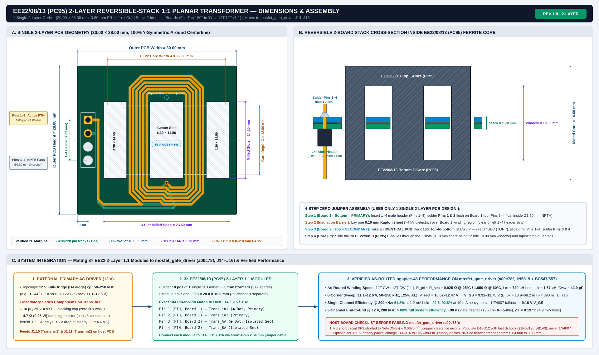

# EE22/08/13 (PC95) 2-Layer Reversible-Stack 1:1 Planar Transformer Module (Rev 1.0)

Production-verified **2-layer, single-Gerber** planar gate-drive transformer module designed for standard **`EE22/08/13` (`PC95`)** Mn-Zn ferrite cores and pin-compatible with the updated `mosfet_gate_driver` (`a00c78f`) **`J14 / J15 / J16`** (`1×4`, `2.54 mm`) headers.

---

## 1. Key Concept — One 2-Layer Gerber, Zero Jumper Wires

Instead of paying for a 4-layer board or fabricating separate Primary and Secondary PCBs, this module uses **one single 100% Y-symmetric 2-layer PCB (`30.00 × 28.00 mm`, `0.80 mm` FR-4, `1 oz` Cu)**:

- **Order quantity 10** of **1 single Gerber ZIP** (`gerbers/JLCPCB_planar_transformer_ee22_2L_0p8mm.zip`) → yields **5 complete `1 : 1` (`12T : 12T`) transformers** (3 active BMS channels + 2 spares) at standard 2-layer prototype pricing.
- **Reversible `1×4` Header (`J1`):**
  - **Pins 1–2:** Active plated through-holes (`1.56 mm` pad / `1.00 mm` drill, `0.28 mm` annular ring; Pad 1 uses `34%` rounded-rect with `1.767 mm` max diagonal so 100% of pad copper fits inside the mating `Ø 1.80 mm` NPTH cylinder).
  - **Pins 3–4:** Isolated **`Ø 1.80 mm` NPTH** pass-through clearance holes (zero copper, `0.860 mm` minimum copper clearance).
- **Stacking 2 Identical Boards:**
  - **Board 1 (Bottom, `F.Cu` UP — silkscreen `"PRI (BOT)"`):** Connects to **Pins 1 & 2** (`Trans_in1`, `Trans_in2`). Pins 3 & 4 pass freely through the `Ø 1.80 mm` NPTH holes.
  - **Insulation Barrier:** One `0.10 mm` Polyimide (Kapton) sheet (`26.8 × 28.0 mm`, `X = 3.20..30.00 mm`) covering 100% of overlapping `F.Cu` winding and lead-in traces (`X ≥ 3.68 mm`, `> 4 kV` dielectric isolation).
  - **Board 2 (Top, identical PCB flipped `180°` around horizontal X-axis — `B.Cu` UP — silkscreen `"SEC (TOP)"` reads right-side-up):** Connects to **Pins 3 & 4** (`Trans_A#`, `Trans_B#`). Pins 1 & 2 pass freely through the `Ø 1.80 mm` NPTH holes.
- **Automatic Mechanical & Via Alignment:**
  - All 3 milled core cutouts, the outer board contour, and the `1×4` (`2.54 mm`) header pitch map onto themselves with **`0.0000 mm` error** when flipped.
  - The inner layer-join via `V_JOIN` (`0.80 / 0.40 mm`, tented) sits at `Y = +8.05 mm` on Board 1 and automatically lands at `Y = -8.05 mm` on flipped Board 2 — **`16.10 mm` separation** (zero stacked-via dielectric hot spots).

---

## 2. Mechanical, Winding & Fabrication Specifications

| Parameter | Verified Value | Notes |
|---|---|---|
| **PCB Outline** | `30.00 × 28.00 mm` | `100%` Y-symmetric around `Y = 14.00 mm` |
| **Stackup (JLCPCB 2-Layer)** | **`0.80 mm` FR-4**, **`1 oz` (`35 µm`) Cu** both sides | `0.73 mm` FR-4 core, lead-free HASL, tented vias |
| **Ferrite Core** | **`EE22/08/13` (`PC95`)** | `A = 22.3`, `B = 8.3` (`16.6` mated), `C = 12.9`, `D = 5.4` (`10.8` window), `E ≥ 15.5`, `F = 5.6 mm`; $A_e = 72.7\text{ mm}^2$, $l_e = 40.6\text{ mm}$, $V_e = 2950\text{ mm}^3$ |
| **Milled Core Cutouts** | Center `6.30 × 14.50 mm` 2× Outer `4.30 × 14.50 mm` | Clears worst-case EE22 core tolerances even with **`Ø 2.0 mm` CNC router bit** (`+0.050 mm` corner margin under `-0.20 mm` fab tolerance!) |
| **Stacked Window Fit** | `1.70 mm` (`0.80 + 0.10 + 0.80`) inside `10.80 mm` window | **`9.10 mm` spare vertical headroom** |
| **Turns Ratio & Winding** | **`1 : 1` (`12T : 12T`)** | `6T` `F.Cu` + `6T` `B.Cu` CW per board (`420 µm` track / `220 µm` turn gap) |
| **Copper-to-Slot Clearance** | **`0.365 mm`** (both `F.Cu` & `B.Cu`) | Direct Gerber & KiCad DRC verified (`≥ 0.350 mm` rule) |
| **Via & Pad Annular Rings** | `V_JOIN`: `0.80/0.40 mm` (`0.20 mm` AR, tented) `J1` Pins 1–2: `1.56/1.00 mm` (`0.28 mm` AR; Pad 1 `1.767 mm` max diag `< Ø 1.80 mm` NPTH) | `3/3` PTH barrels have intact outer copper pads on both `F.Cu` & `B.Cu` |
| **Winding Length & Resistance** | `773.83 mm` / board (`MLT_eff = 64.49 mm`) | **`R_pri = R_sec = 0.925 Ω @ 25 °C`** / **`1.050 Ω @ 60 °C`** |
| **Magnetizing / Leakage / C_ww** | `L_m = 720 µH` nom (`540–900 µH`) | `L_lk = 1.57 µH`, `C_ww = 42.9 pF` |

---

## 3. Header Pinout & Phase Polarity (`mosfet_gate_driver` `a00c78f` `J14–J16`)

Flipping Board 2 `180°` around the horizontal X-axis reverses top-view spiral handedness (`CW → CCW`), so current entering **Pin 3 (`Trans_A#`)** circulates `CW` in-phase with current entering **Pin 1 (`Trans_in1`)**:

| Header Pin (`2.54 mm`) | Host Net (`J14 / J15 / J16`) | Active Board | Hole Type | Phase Polarity |
|---|---|---|---|---|
| **Pin 1** (`Y = 10.19 mm`) | `/Trans_in1` | Board 1 (Bottom, `PRI`) | `1.56 / 1.00 mm` PTH (RoundRect) | **● Dot (Primary +)** |
| **Pin 2** (`Y = 12.73 mm`) | `/Trans_in2` | Board 1 (Bottom, `PRI`) | `1.56 / 1.00 mm` PTH (Circle) | Primary − |
| **Pin 3** (`Y = 15.27 mm`) | `/Trans_A#` | Board 2 (Top, `SEC`, flipped) | `Ø 1.80 mm` NPTH on B1 / PTH on B2 | **● Dot (Secondary +)** |
| **Pin 4** (`Y = 17.81 mm`) | `/Trans_B#` | Board 2 (Top, `SEC`, flipped) | `Ø 1.80 mm` NPTH on B1 / PTH on B2 | Secondary − |

---

## 4. As-Routed `ngspice-46` Verification Results

All simulations use exact extracted geometry (`R_dc60 = 1.050 Ω`, Dowell AC skin/proximity factor $F_R$, `L_lk = 1.57 µH`, `C_ww = 42.9 pF`, `PC95` Steinmetz core loss).

### 4.1 Eight-Corner Single-Channel Matrix (`sim/run_asrouted_sim.py` — 8/8 PASS)

| Corner | Conditions (`V_bus`, `f_sw`, `I_load`, `L_m`, Diode) | `V_rect` (V) | `V_GS` (V) | `B_pk` (mT) | Eff. | Status |
|---|---|---:|---:|---:|---:|---|
| **E1** | `11.1 V`, `200 kHz`, `10 mA`, `900 µH`, `1N5819` | `10.62–10.63` | `9.92` | `15.4` | `92.8%` | **PASS** |
| **E2** | `11.1 V`, `200 kHz`, `1.2 mA`, `900 µH`, `1N5819` | `10.87–10.88` | `10.17` | `15.4` | `61.9%` | **PASS** |
| **E3** | `12.0 V`, `200 kHz`, `1.2 mA`, `720 µH`, `1N5819` | `11.75–11.76` | `11.05` | `16.6` | `61.8%` | **PASS** |
| **E4** | `12.0 V`, `200 kHz`, `10 mA`, `720 µH`, `1N5819` | `11.51–11.52` | `10.81` | `16.6` | `92.6%` | **PASS** |
| **E5** | `12.0 V`, `100 kHz`, `1.2 mA`, `540 µH`, `1N5819` | `11.72` | `11.02` | `33.8` | `55.2%` | **PASS** |
| **E6** | `12.0 V`, `50 kHz`, `1.2 mA`, `540 µH`, `1N5819` | `11.72` | `11.02` | `68.2` | `35.8%` | **PASS** |
| **E7** | `12.6 V`, `250 kHz`, `0.05 mA`, `540 µH`, `1N5819` | `12.45–12.47` | `11.75` | `13.9` | — | **PASS** |
| **E8** | `11.1 V`, `150 kHz`, `1.2 mA`, `720 µH`, `UF4007` | `9.86` | `9.16` | `20.5` | `62.4%` | **PASS** |

*Peak flux density remains `13.9–68.2 mT`, over `5.7×` below `PC95` saturation (`~390 mT @ 100 °C`).*

### 4.2 Full 3-Channel End-to-End BMS System (`12 V` H-Bridge @ `200 kHz` + `10 µF` + `4.7 Ω` + `BC547/BC557` + `1960 pF` Gate)

- **System Efficiency (all 3 channels loaded):** **`81.2%`**
- **Rectified Rails:** `V_rect1 = 11.77 V` (`16.3 mVpp` ripple), `V_rect3 (10 mA) = 11.51 V`
- **MOSFET Gate Drive (`IRF540N` `1960 pF`):** `V_GS(ON) = 10.52 V`, `V_GS(OFF) = 0.78 mV`, **`t_rise = 91.4 ns`**, **`t_fall = 97.6 ns`**
- **Cold-Start Inrush & DC Balance:** Peak primary startup current **`1.82 A`** (capped from `6.58 A` by the `4.7 Ω` series damper); steady-state DC-block offset **`2.96 mV`**
- **Thermal Dissipation:** **`4.87 mW`** total transformer loss per channel → **`ΔT ≈ 0.19 °C`** above ambient

---

## 5. Step-by-Step Assembly Instructions (Zero Interior Solder Fillets)

1. **Cut Full-Coverage Insulation Barrier (`26.8 × 28.0 mm`):** Cut one **`0.10 mm` Kapton (Polyimide) sheet** to `26.8 mm` wide × `28.0 mm` tall (aligned with the right, top, and bottom board edges so it spans **`X = 3.20 .. 30.00 mm`**), notched around the 3 milled core cutouts. This clears `J1` holes (`X ≤ 2.90 mm`) by `0.30 mm` while covering **100% of overlapping `F.Cu` Primary/Secondary copper (`X ≥ 3.68 mm`)**.
2. **Stack Board 1 (`PRI (BOT)`), Kapton, and Flipped Board 2 (`SEC (TOP)`):** Place Board 1 (`F.Cu` facing UP, `"PRI (BOT)"` visible), lay the `0.10 mm` Kapton sheet (`X = 3.20 .. 30.00 mm`), and place a **second identical PCB** flipped **`180°` top-to-bottom** (`B.Cu` facing UP so `"SEC (TOP)"` reads right-side-up) flat on top (`1.70 mm` total stack height, zero interior solder cones).
3. **Insert `1×4` `2.54 mm` Right-Angle Header (`61300411021`, Recommended) & Solder Outer Faces Only:** Insert the `3.0–3.2 mm` through-hole tails from the top of Board 2 through the `1.70 mm` stack (`~1.4 mm` tail protruding out the bottom of Board 1; `6.0 mm` horizontal mating pins extending off the left `X = 0` edge completely unobstructed). Solder **Pins 3 & 4 on the OUTER TOP (`B.Cu`) of Board 2**, and flip the stack over to solder **Pins 1 & 2 on the OUTER BOTTOM (`B.Cu`) of Board 1**. *(Never place solder fillets on the interior `F.Cu` faces between Board 1 and Board 2, so both boards seat 100% flush against the `0.10 mm` Kapton barrier).*
4. **Fit `EE22/08/13` (`PC95`) Ferrite Core:** Slide the two E-core halves together through the 3 milled cutouts (`9.10 mm` spare window height). Bind the outer legs cleanly with Kapton tape or a dab of epoxy under light clamp pressure so the mating faces sit flush (zero air gap).
5. **Connect to `mosfet_gate_driver` (`J14 / J15 / J16`):** Connect each of the 3 modules to `J14`, `J15`, and `J16` using **short (`≤ 50 mm`) 4-pin `2.54 mm` female-to-female jumper/IDC cables** (preserving Pin 1 → Pin 1 orientation; twist Pins 1–2 and Pins 3–4 tightly to minimize stray lead inductance). *Note:* On `mosfet_gate_driver` (`a00c78f`), `J16↔J15` (`14.19 mm`) and `J15↔J14` (`14.27 mm`) are narrower than both the `28.00 mm` PCB height and `16.60 mm` mated `EE22` core thickness, so all 3 modules cannot direct-plug side-by-side without short cables.

---

## 6. Primary Drive & Host Board Integration Checklist

- **Primary Drive (`Trans_in1 / Trans_in2` on Host `J1.10 / J1.11`):** Because this is a **`1 : 1`** transformer, drive `Trans_in1 / Trans_in2` with a **bipolar `±12 V` H-bridge** (`11.1–12.6 V` 3S rail, `150–250 kHz`, `50%` duty) — do **not** use a `5 V` MCU pin directly.
- **Mandatory Series Protection on `Trans_in1`:** Place **`10 µF 25 V X7R`** (`C_DCBLOCK`) + **`4.7 Ω 0.25 W`** (`R_INRUSH`) in series with `Trans_in1` (1 shared pair serves all 3 channels). This prevents DC flux-walk saturation and limits 3-channel cold-start surge to `1.82 A` while losing only `0.16 V` at steady state.
- **Host Rectifier Diodes (`D1–D12`):** Populate with **fast Schottky axial diodes (`1N5819` or `SB140`)** — never `1N4007` (`t_rr ≈ 2 µs` collapses `200 kHz` rectification).
- **Before Fabricating `mosfet_gate_driver` (`a00c78f`):** Fix the existing `/P3` to `Net-(Q5-B)` short circuit and `0.0675 mm` copper clearance violation on the host board. For battery packs **above `60 V`**, upgrade `J14–J16` to a `1×5` header with Pin 3 left empty to triple Primary–Secondary creepage (`0.84 mm → 3.38 mm`).

---

## 7. Ordering & Fabrication Settings (JLCPCB 2-Layer)

Upload **`gerbers/JLCPCB_planar_transformer_ee22_2L_0p8mm.zip`** directly with:

- **Layers:** `2`
- **Dimensions:** `30.00 × 28.00 mm`
- **Quantity:** `10` (makes `5` complete transformers: `3` channels + `2` spares)
- **PCB Thickness:** **`0.8 mm`** (mandatory to keep stack height `1.70 mm` and tight coupling)
- **Outer Copper Weight:** **`1 oz`** (`35 µm` on both sides)
- **Surface Finish:** LeadFree HASL (or ENIG)
- **Via Covering:** Tented
- **Remove Order Number:** Optional (clear silkscreen margins maintained)

---

## 8. Directory Structure & Verification Audits

| Path | Description |
|---|---|
| `planar_transformer_ee22_2l.kicad_pro/.sch/.pcb/.kicad_dru` | KiCad 10.0.6 source project (`0` ERC, `0` DRC, `0` parity, `0` unconnected) |
| `gerbers/JLCPCB_planar_transformer_ee22_2L_0p8mm.zip` | Ready-to-order JLCPCB 2-layer Gerber + Excellon drill archive |
| `renders/ee22_2l_dimensions_assembly.svg` | 3-panel engineering dimension, stack cross-section & wiring diagram |
| `renders/top_3d.png`, `renders/bot_3d.png`, `renders/schematic.pdf` | 3D top/bottom renders & PDF schematic |
| `bom.csv` | Complete 1-channel and 3-channel bill of materials |
| `sim/run_asrouted_sim.py` & `sim/E1..E8.*` | As-routed 8-corner `ngspice-46` simulation suite & logs |
| `build_ee22_2l.py`, `verify_windings.py`, `full_audit.py` | Deterministic generator, geometric/symmetry verifier & full ERC/DRC/SPICE audit |
